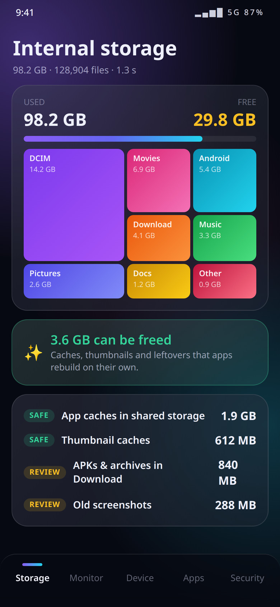
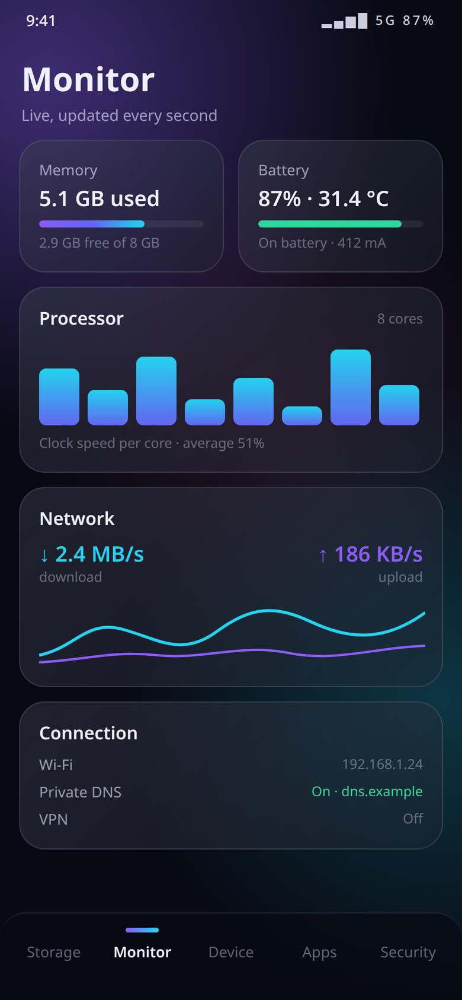
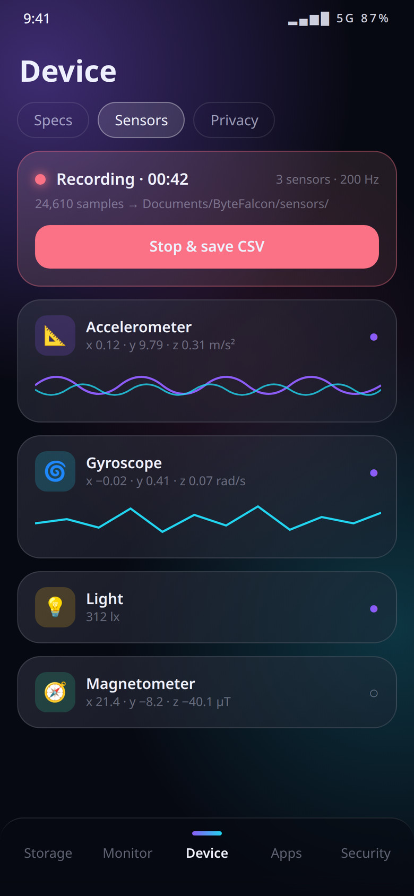
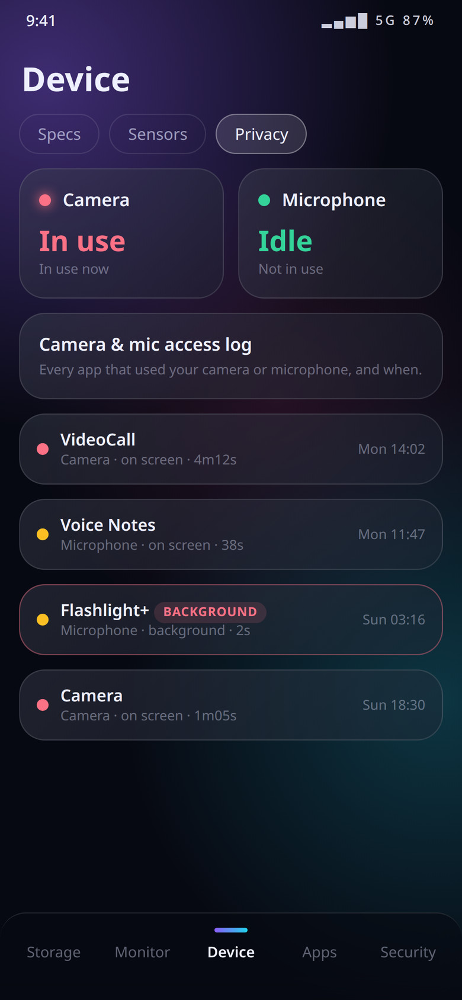
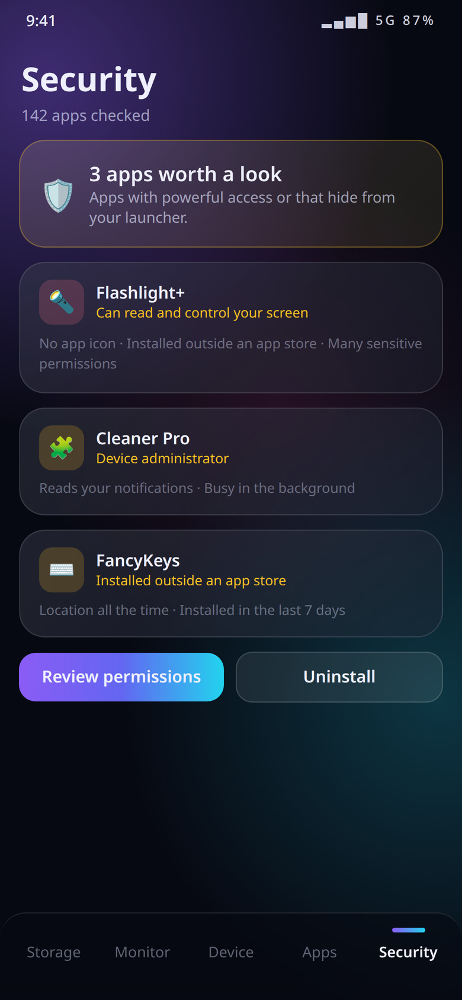

<p align="center">
  
</p>

<p align="center">
  <b>Your phone's storage cleaner, live monitor, privacy watchdog and sensor lab, in one native app.</b><br>
  No ads. No tracking. No internet permission at all.
</p>

<p align="center">
  
  
  
  
</p>

<p align="center">
  
  
  
  
  
</p>
<p align="center"><sub>Mockups with sample data. Your own phone's numbers will differ.</sub></p>

---

> 📱 Also on desktop: **[ByteFalcon for Linux](https://github.com/mahbub2649/ByteFalcon)**

## What's inside

ByteFalcon has five tabs. Here's what each one does, in plain words.

### 💾 Storage: find what's filling your phone
- Scans your whole phone in about **a second**, using a native C++ engine instead of slow Java file APIs.
- A colorful **treemap** shows which folders are biggest. Tap to dive in, tap a file to open it.
- **Smart Clean** finds space you can get back, and labels each find:
  - **SAFE**: things apps rebuild by themselves, like thumbnail caches, app caches and unfinished downloads.
  - **REVIEW**: worth a quick look first, like old APKs, big old downloads, chat media and old screenshots.
- Finds **duplicate files** and the **largest files** on your phone.

### 📊 Monitor: see what your phone is doing right now
- Live **memory**, **battery** (charge, temperature, current) and **CPU** load per core.
- Live **download and upload speed**, plus your connection details (Wi-Fi or mobile, DNS, VPN).
- **Data used per app**, so you can spot the app that's quietly eating your data plan.
- **Free up memory** by stopping other apps' background processes.

### 📱 Device: specs, sensors and privacy
- **Specs:** processor, memory, display, battery health, cameras. Everything about your hardware on one page.
- **Sensors:** every sensor in your phone, with live charts.
  - **Record sessions for machine learning:** pick sensors, press record, and get clean **CSV files** (one per sensor, nanosecond timestamps, plus a README) in `Documents/ByteFalcon/sensors/`.
- **Privacy:** shows the moment any app turns on your **camera** or **microphone**, and keeps a **log of which app used them, and when**.

### 📦 Apps: everything that's installed
- Every app with its size, permissions and last use.
- **Uninstall** in one tap. For pre-installed **bloatware** that can't normally be removed, ByteFalcon gives you the exact `adb` command.

### 🛡️ Security: spot shady apps
Flags apps that deserve a second look, and explains why in plain English:

| Flag | What it means |
|---|---|
| Can read and control your screen | Has an Accessibility service on: it can see your screen and tap for you |
| Device administrator | Can lock or wipe your phone, and is harder to uninstall |
| No app icon | Installed, but hides from your app drawer |
| Installed outside an app store | Not from Google Play or your phone maker's store |
| Reads your notifications | Sees every notification, including message previews and login codes |
| Location all the time | Can track you even when you're not using it |

## 🔒 Privacy first

- **No internet permission.** ByteFalcon *can't* send anything anywhere. Android enforces this, not a promise.
- **No ads, no analytics, no accounts.**
- Deletions use Android's own system dialogs where possible, and the native cleaner refuses to touch system folders.

## 🚀 Install

### Option 1: build it yourself

You need **Android Studio** (or the Android SDK with **NDK 27** and **CMake 3.22**) and a phone with **USB debugging** on.

```bash
git clone https://github.com/mahbub2649/ByteFalcon-Android.git
cd ByteFalcon-Android
./gradlew assembleRelease
adb install -r app/build/outputs/apk/release/app-release.apk
```

### Option 2: Android Studio
Open the folder, press **Run ▶**, and pick your phone.

### First launch
1. Tap **Grant access** → turn on **All files access** (Android 11+) or allow **Storage** (Android 10), so the scanner can read your files.
2. *(Optional)* turn on **Usage access** for per-app data use and app activity.
3. *(Optional)* the **camera & mic access log** reads Android's own access records. That needs one permission that only a computer can grant:
   ```bash
   adb shell pm grant app.diskscan android.permission.DUMP
   ```

## ⚙️ Under the hood

<details>
<summary>For the curious</summary>

| Part | Built with |
|---|---|
| Scanner, cleaner, duplicate finder | **C++17 via the NDK**: parallel `getdents64` + `statx` with an `fstatat` fallback for Android 10, XXH64 hashing |
| UI | **Kotlin + Jetpack Compose**, custom glass design, no WebView |
| Live stats | `/proc`, `BatteryManager`, `NetworkStatsManager`, `UsageStatsManager` |
| Camera/mic | `CameraManager` + `AudioManager` callbacks, plus app-ops history |
| Sensor recorder | `SensorManager` on a dedicated thread, buffered CSV writer |

- Minimum Android 10 (API 29), target API 36, 64-bit ARM.
- The release build is signed with the debug key for local installs. Use your own key to distribute it.

</details>

## 💬 Feedback

Found a bug or have an idea? [Open an issue](https://github.com/mahbub2649/ByteFalcon-Android/issues). Stars ⭐ help others find it!
